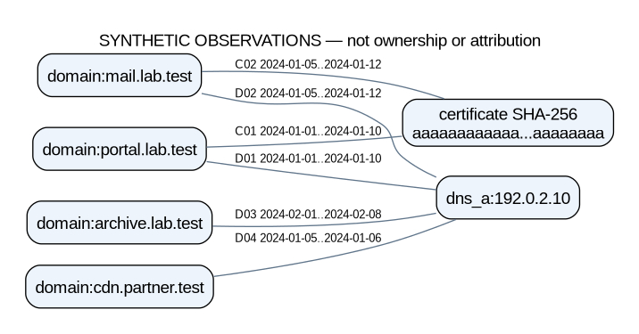

# Infrastructure Relationship Mapping
Offline-пайплайн: разрешённые исторические DNS A и сертификатные fingerprint
наблюдения → граф JSON/DOT → временная корреляция доменов.
Подтверждаемые навыки: scope control, data validation, evidence IDs,
временные интервалы, осторожная интерпретация графа.

## Запуск
Python 3.11+, зависимостей нет. Из корня репозитория:
~~~sh
python3 mapping.py
python3 -m unittest discover -s tests -v
~~~
Результат в игнорируемой local/result/. Проверенный пример в examples/.\n\n\n\nPNG — визуализация исходных наблюдений, а не временных связей relationships.\nПолные fingerprint сохранены в JSON; в картинке они сокращены.
Graphviz необязателен: при наличии можно выполнить
~~~sh
dot -Tsvg examples/graph.dot -o local/graph.svg
~~~
Программа не делает DNS/HTTP-запросов, сканирования или рекурсивного расширения scope.

## Данные и разрешение
data/scope.json — точный allowlist, тип набора, основание разрешения.
data/observations.csv — 6 полностью синтетических наблюдений с учебными датами
2024 года. Это не архив реальной инфраструктуры и не данные кампании из другого
репозитория. Домены .test и адреса TEST-NET зарезервированы для примеров:
[RFC 2606](https://www.rfc-editor.org/rfc/rfc2606),
[RFC 5737](https://www.rfc-editor.org/rfc/rfc5737). Доступ: 2026-11-13.

Поля CSV: уникальный id, domain, kind (dns_a / certificate_sha256), value,
first_seen / last_seen (ISO date), source (идентификатор происхождения).
Сертификатный fingerprint — SHA-256 сертификата, не хеш файла malware.
Интервалы означают границы наблюдений, не непрерывное использование.
Даты DNS-наблюдений не подменяются датами валидности сертификата.

Для собственных данных: сохраните выгрузку в local/, используйте
dataset_kind=authorized_historical, точный список разрешённых доменов и
authorization_note с основанием разрешения. Не публикуйте сам документ
авторизации или сведения о клиентах.
~~~sh
python3 mapping.py --input local/observations.csv --scope local/scope.json --output local/result
~~~
Конфигурация не доказывает право на данные: это обязанность оператора.
Ограничения CLI: 1 MB и 1000 наблюдений; прямые библиотечные вызовы предназначены
для доверенных небольших наборов.

## Что показывает демонстрация
4 связи: три пары по общему IP и одна по сертификату.
archive.lab.test использует тот же IP в другом интервале и не получает
временной связи. cdn.partner.test моделирует ложный след shared hosting.
Подробный разбор — examples/analysis.md. В графе сохраняются все исходные
наблюдения; relationships содержит только пересечения интервалов.

## Ограничения
Общий IP, CDN, wildcard или сертификат не доказывают общего владельца.
Даже совпадающие интервалы наблюдений не доказывают одновременное использование.
Нет ASN/WHOIS/CT collector: допускается только импорт разрешённых выгрузок.
Нет attribution, оценки maliciousness и автоматического pivot на соседние домены.
GitHub Actions: [успешный запуск на Python 3.11](https://github.com/phiorae/infrastructure-relationship-mapping/actions/runs/43427254970), 2026-11-13.
